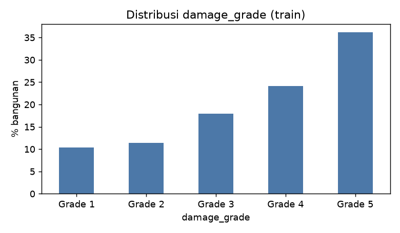
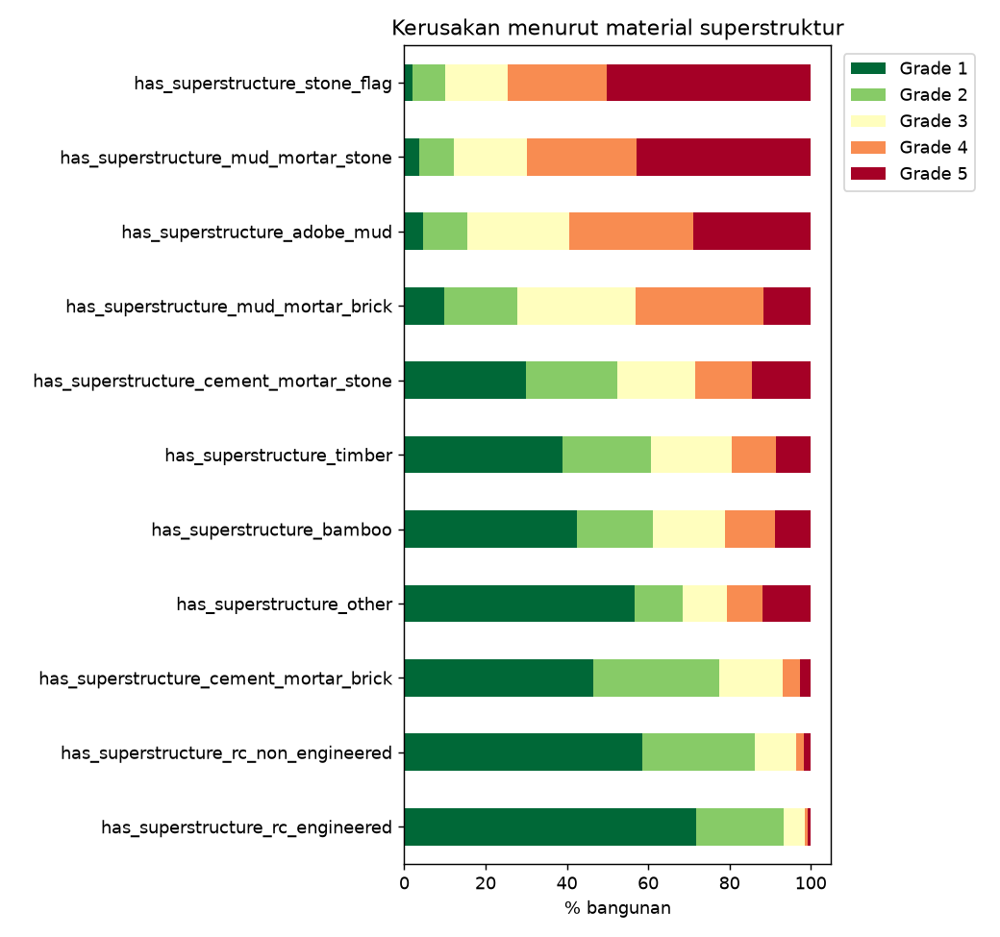
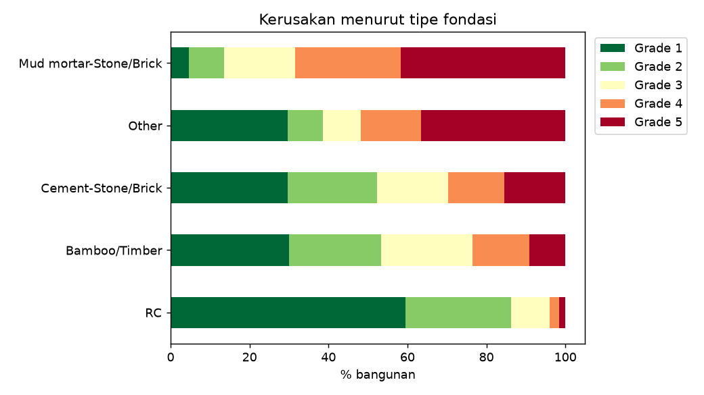
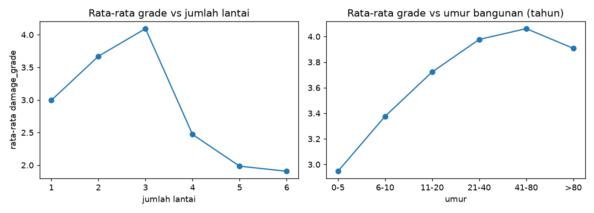
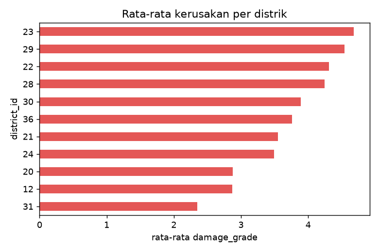
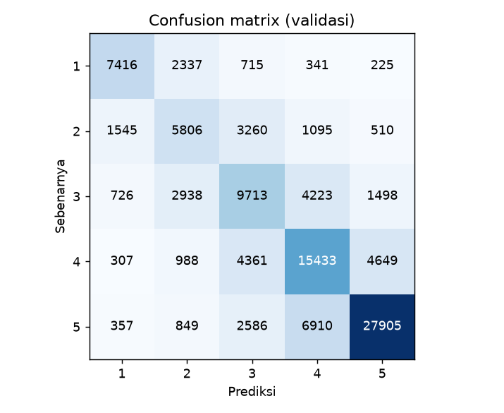
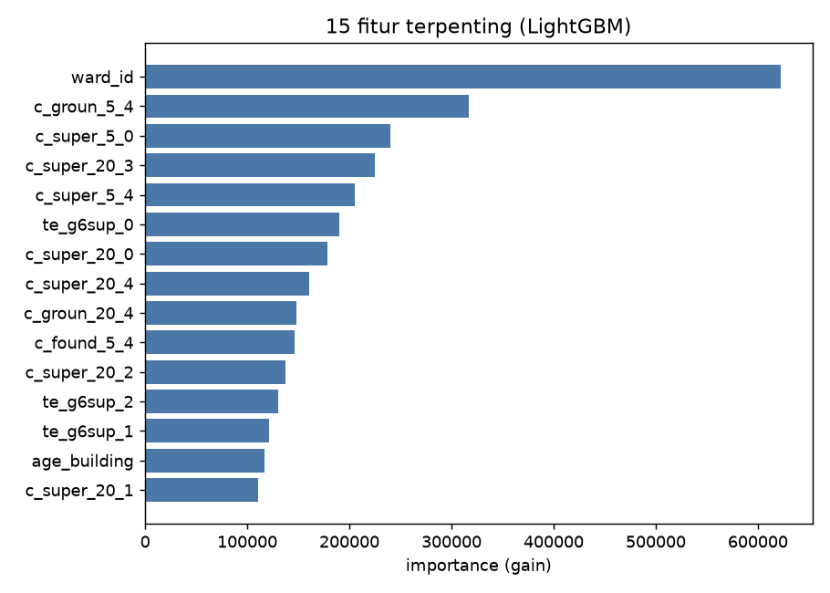
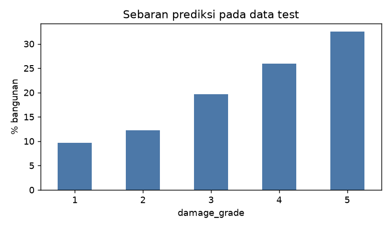

# Klasifikasi Tingkat Kerusakan Bangunan Pasca Gempa Gorkha, Nepal (2015)

Project ini memprediksi **tingkat kerusakan bangunan (`damage_grade`, skala 1 sampai 5)** setelah gempa bumi Gorkha, Nepal, pada 25 April 2015 (magnitudo 7,8 Mw). Prediksi dibuat dari data karakteristik bangunan dan lokasinya.

- Kompetisi Kaggle: https://www.kaggle.com/t/a9196b92680b4492aeb06aeaee94f654
- Repository: https://github.com/alyciazada/Structural-Damage-Classification

## Ringkasan Hasil

| Item | Hasil |
|---|---|
| Model | LightGBM (gradient boosting berbasis pohon keputusan), tanpa Neural Network |
| Metrik kompetisi | Macro F1-Score |
| Macro F1 validasi | **0,596** |
| Akurasi validasi | **0,621** |
| Public Score Kaggle | **0.59986** |

Skor validasi dihitung pada 20% data latih (106.693 bangunan) yang disisihkan dan tidak dipakai untuk melatih model.

## Latar Belakang

Gempa bumi Gorkha terjadi di kedalaman yang dangkal sehingga merusak ratusan ribu bangunan. Setelah bencana, Central Bureau of Statistics (CBS) Nepal mensurvei bangunan yang terdampak. Data survei mencatat kondisi bangunan sebelum gempa (jenis fondasi, material dinding, atap, umur, jumlah lantai, dan kondisi tanah) beserta tingkat kerusakan yang dialaminya.

Tujuan project ini adalah membuat model yang bisa memperkirakan tingkat kerusakan sebuah bangunan dari karakteristiknya. Model seperti ini dapat membantu memprioritaskan bangunan yang perlu diperiksa atau dibangun ulang.

## Dataset

Data diambil dari kompetisi Kaggle dan **tidak disimpan di repository ini** karena ukurannya besar.

| File | Isi |
|---|---|
| `train.csv` | 533.465 bangunan, lengkap dengan `damage_grade` |
| `test.csv` | 228.629 bangunan yang harus diprediksi |
| `sample_submission.csv` | contoh format file pengumpulan |

Kolom utama:
- **Lokasi:** `district_id`, `vdcmun_id`, `ward_id`
- **Ukuran bangunan:** `count_floors_pre_eq` (jumlah lantai), `plinth_area_sq_ft` (luas), `height_ft_pre_eq` (tinggi), `age_building` (umur)
- **Jenis bangunan:** `foundation_type`, `roof_type`, `ground_floor_type`, `other_floor_type`, `position`, `plan_configuration`, `land_surface_condition`, `superstructure`
- **Target:** `damage_grade` (Grade 1 sampai Grade 5, makin besar makin parah)

## Struktur Repository

```
Structural-Damage-Classification/
│
├── README.md
├── .gitignore
├── requirements.txt
│
├── data/
│   └── .gitkeep                  # folder untuk train.csv, test.csv, sample_submission.csv (unduh sendiri)
│
├── notebooks/
│   ├── 01_eda.ipynb              # eksplorasi data
│   ├── 02_modeling.ipynb         # pembuatan fitur, pipeline, validasi, pelatihan model
│   └── 03_submission.ipynb       # prediksi data test dan pembuatan file submission
│
├── scripts/
│   ├── __init__.py
│   ├── config.py                 # path, daftar kolom, parameter model
│   ├── preprocess.py             # memuat data, fitur dasar, ColumnTransformer
│   ├── feature_engineering.py    # fitur lokasi dan fitur tetangga
│   ├── train.py                  # pipeline, validasi, tuning bobot kelas, pelatihan akhir
│   └── predict.py                # prediksi dan pembuatan submission.csv
│
├── models/
│   ├── pipeline_model_lgbm.pkl   # pipeline model yang sudah dilatih
│   └── cfg3.json                 # bobot kelas hasil tuning (dibaca saat prediksi)
│
├── submissions/
│   └── submission.csv            # file yang diunggah ke Kaggle
│
└── reports/
    └── figures/                  # gambar hasil analisis
```

| Folder/File | Fungsi |
|---|---|
| `README.md` | Dokumentasi utama proyek |
| `.gitignore` | Daftar file yang tidak di-commit (misalnya data CSV besar) |
| `requirements.txt` | Daftar library Python yang dibutuhkan |
| `data/` | Tempat dataset dari Kaggle |
| `notebooks/` | Notebook untuk eksplorasi, pemodelan, dan submission |
| `scripts/` | Kode Python yang dibuat modular, setiap function dan class diberi docstring |
| `models/` | Model yang sudah dilatih dan konfigurasinya |
| `submissions/` | File hasil prediksi untuk Kaggle |
| `reports/figures/` | Gambar hasil analisis |

## Cara Menggunakan Repository

### 1. Clone repository dan pasang library

```bash
git clone https://github.com/alyciazada/Structural-Damage-Classification.git
cd Structural-Damage-Classification
python -m venv venv
venv\Scripts\activate
pip install -r requirements.txt
```

### 2. Unduh data dari Kaggle

Data tidak ada di GitHub. Bergabunglah dulu ke kompetisi dan terima aturannya di Kaggle, lalu unduh data dengan salah satu cara:

- **Manual:** buka tab *Data* pada halaman kompetisi, klik *Download All*, lalu ekstrak `train.csv`, `test.csv`, dan `sample_submission.csv` ke folder `data/`.
- **Kaggle CLI:**
```bash
  kaggle competitions download -c structural-damage-classification -p data/
```
  Setelah itu ekstrak file zip-nya ke folder `data/`.

### 3. Jalankan notebook

Jalankan secara berurutan dari folder `notebooks/` (menu *Run All*):

1. `01_eda.ipynb` untuk eksplorasi data dan gambar analisis.
2. `02_modeling.ipynb` untuk membuat fitur, melatih model, mengukur performa, lalu menyimpan model ke `models/`.
3. `03_submission.ipynb` untuk memuat model, memprediksi data test, dan membuat `submissions/submission.csv`.

### 4. Alternatif lewat script

Dari folder utama repository:

```bash
python -m scripts.train      # latih model, simpan model, dan buat submission
python -m scripts.predict    # hanya prediksi dari model yang sudah tersimpan
```

### 5. Unggah ke Kaggle

Unggah `submissions/submission.csv` pada tab *Submit Predictions* di halaman kompetisi. Kolom `damage_grade` berisi angka 1 sampai 5.

## Alur Analisis (Workflow)

```
Data mentah (train.csv, test.csv)
        |
        v
1. Eksplorasi data (EDA)
   cek data kosong, sebaran kelas, hubungan fitur dengan kerusakan
        |
        v
2. Fitur dasar
   umur dipotong maksimal 200, luas dan tinggi per lantai, kelompok lokasi dari building_id
        |
        v
3. Fitur lokasi dan tetangga
   rata-rata tingkat kerusakan per wilayah dan per bangunan di sekitarnya
   (dihitung dengan cara out-of-fold supaya tidak "mencontek" label)
        |
        v
4. Pengubahan tipe kolom
   kolom kategori dan ID wilayah dijadikan tipe category
        |
        v
5. Model LightGBM
   dilatih dengan early stopping pada data validasi
        |
        v
6. Penyetelan untuk Macro F1
   bobot tiap kelas dicari agar Macro F1 setinggi mungkin
        |
        v
7. Pelatihan akhir dan prediksi
   model dilatih ulang pada seluruh data latih, lalu memprediksi data test
```

### Penggunaan Pipeline dan ColumnTransformer

Semua tahap pemrosesan sampai model digabung dalam satu `Pipeline` scikit-learn (lihat `build_pipeline` di `scripts/train.py`).

| Langkah | Komponen | Fungsi |
|---|---|---|
| `features` | `ColumnTransformer` berisi `BaseFeatureBuilder` dan `LocationFeatureBuilder` | membuat fitur dasar dan fitur lokasi/tetangga |
| `encode` | `ColumnTransformer` berisi `CategoryEncoder` | mengubah kolom kategori ke tipe `category` |
| `model` | `LGBMBoosterClassifier` | model LightGBM |

Dengan satu pipeline, langkah pemrosesan pada data latih dan data test dijamin sama, sehingga hasilnya konsisten dan mudah diulang.

## Mengapa pakai method out-of-fold?

Fitur lokasi dibuat dari label (tingkat kerusakan) bangunan di sekitarnya. Kalau sebuah bangunan ikut dihitung dalam fiturnya sendiri, model seolah-olah "mengintip" jawabannya, dan skor validasi menjadi terlalu bagus. Karena itu data latih dibagi 10 bagian. Fitur setiap bagian dihitung hanya dari 9 bagian lainnya. Untuk data test, fitur dihitung dari seluruh data latih.

## Hasil Eksplorasi Data (EDA)

Angka berikut dihitung dari 533.465 bangunan di data latih. Tidak ada nilai kosong dan tidak ada `building_id` ganda. Nilai umur bangunan punya data ekstrem (maksimum 999 tahun), jadi nilainya dipotong di 200.

### Sebaran kelas

| Grade | Persentase |
|---|---|
| Grade 1 | 10,3% |
| Grade 2 | 11,4% |
| Grade 3 | 17,9% |
| Grade 4 | 24,1% |
| Grade 5 | 36,2% |

Kelas tidak seimbang: Grade 5 jauh lebih banyak daripada Grade 1 dan 2. Karena itu metrik yang dipakai adalah Macro F1, yang memperlakukan semua kelas sama penting, bukan akurasi biasa.



### Material bangunan sangat berpengaruh

- Bangunan dengan superstruktur batu (`stone_flag`): 50,2% mengalami kerusakan terparah (Grade 5).
- Batu dengan mortar lumpur (`mud_mortar_stone`): 42,8% Grade 5.
- Beton bertulang yang direkayasa (`rc_engineered`): hanya 0,7% Grade 5, dan 71,9% hanya Grade 1.
- Jenis fondasi menunjukkan pola yang sama: fondasi batu/bata dengan mortar lumpur 41,7% Grade 5, sedangkan fondasi beton bertulang (RC) 59,5% Grade 1.




### Jumlah lantai dan umur bangunan

- Rata-rata grade naik dari 2,99 (1 lantai) menjadi 4,09 (3 lantai). Bangunan dengan 4 lantai atau lebih jumlahnya sangat sedikit dan rata-ratanya justru turun (sekitar 2,0 sampai 2,5). Kemungkinan karena bangunan tinggi lebih sering memakai beton bertulang.
- Bangunan yang lebih tua cenderung lebih rusak: rata-rata 2,95 untuk umur 0 sampai 5 tahun, dan sekitar 4,06 untuk umur 41 sampai 80 tahun.



### Lokasi

Rata-rata tingkat kerusakan antar distrik berbeda jauh, dari 2,35 (distrik 31) sampai 4,68 (distrik 23). Ini wajar karena kekuatan guncangan berbeda di tiap daerah. Itulah alasan fitur lokasi dan fitur tetangga dibuat.



## Hasil Model

### Skor keseluruhan (data validasi, 106.693 bangunan)

| Macro F1 tanpa bobot kelas (argmax biasa) | 0,591 |
| **Macro F1 setelah bobot kelas** | **0,596** |
| Akurasi | 0,621 (dengan bobot kelas; tanpa bobot 0,626) |
| Iterasi terbaik (early stopping) | 328 |
| Bobot kelas hasil tuning | Grade 1 = 0,8; Grade 2 = 1,2; Grade 3 = 1,2; Grade 4 = 1,1; Grade 5 = 0,8 |

### Skor per kelas

| Grade | Precision | Recall | F1-score | Jumlah data |
|---|---|---|---|---|
| 1 | 0,716 | 0,672 | 0,694 | 11.034 |
| 2 | 0,449 | 0,475 | 0,462 | 12.216 |
| 3 | 0,471 | 0,509 | 0,489 | 19.098 |
| 4 | 0,551 | 0,600 | 0,574 | 25.738 |
| 5 | 0,802 | 0,723 | 0,760 | 38.607 |
| **Macro avg** | 0,598 | 0,596 | **0,596** | 106.693 |
| Weighted avg | 0,633 | 0,621 | 0,626 | 106.693 |

Penjelasan singkat istilah:
- **Precision:** dari semua bangunan yang diprediksi masuk suatu kelas, berapa yang benar.
- **Recall:** dari semua bangunan yang sebenarnya masuk suatu kelas, berapa yang berhasil ditemukan.
- **F1-score:** rata-rata gabungan precision dan recall.
- **Macro F1:** rata-rata F1 dari kelima kelas, tanpa memedulikan jumlah data tiap kelas.

### Confusion matrix



### Fitur yang paling berpengaruh



### Sebaran prediksi pada data test



## Interpretasi Hasil

1. **Kelas ekstrem paling mudah ditebak.** Grade 5 (F1 0,760) dan Grade 1 (F1 0,694) memiliki skor tertinggi. Ciri bangunannya jelas: bangunan batu atau lumpur cenderung rusak total, sedangkan bangunan beton bertulang cenderung hanya rusak ringan.
2. **Kelas tengah paling sulit.** Grade 2 (F1 0,462) dan Grade 3 (F1 0,489) memiliki skor terendah. Tingkat kerusakannya berdekatan, dan penilaian surveyor di batas antar-grade bisa berbeda-beda, sehingga ciri bangunannya mirip tetapi labelnya berbeda. Pada data berskala ordinal seperti ini, kesalahan biasanya terjadi antar kelas yang bersebelahan (silakan cocokkan dengan confusion matrix di atas).
3. 3. **Penyetelan bobot kelas memberi peningkatan kecil.** Macro F1 naik dari 0,591 menjadi 0,596. Bobotnya menaikkan peluang Grade 2, 3, dan 4 (1,2; 1,2; 1,1) dan menurunkan Grade 1 dan 5 (0,8). Dengan begitu kelas tengah yang sulit ditebak lebih sering terpilih, sehingga precision dan recall tiap kelas menjadi seimbang. Akurasi sedikit turun (0,626 menjadi 0,621) karena Macro F1 yang dikejar, bukan akurasi.
4. **Akurasi (0,621) lebih tinggi daripada Macro F1 (0,596).** Hal ini wajar pada data yang kelasnya tidak seimbang, karena akurasi lebih dipengaruhi kelas besar yang lebih mudah ditebak.
5. **Fitur penting.** Fitur paling berpengaruh adalah `ward_id` (nomor wilayah), disusul fitur tetangga bersyarat seperti `c_groun_5_4`, `c_super_5_0`, dan `c_super_20_3`, serta fitur `te_g6sup_*` (rata-rata kerusakan menurut lokasi dan jenis superstruktur). Fitur bangunan murni yang masuk 15 besar hanya `age_building` (umur bangunan). Artinya, model sangat mengandalkan **lokasi dan kondisi bangunan sejenis di sekitarnya**, sejalan dengan temuan EDA bahwa kerusakan sangat berbeda antar wilayah dan antar material bangunan. Nama fitur `c_*` berarti rata-rata tingkat kerusakan pada tetangga dengan jenis superstruktur (`super`), lantai dasar (`groun`), atau fondasi (`found`) yang sama.

## Kesimpulan

Model LightGBM yang dibungkus dalam Pipeline dan ColumnTransformer berhasil memprediksi tingkat kerusakan bangunan pasca gempa Gorkha dengan **Macro F1 0,596** dan **akurasi 0,621** pada data validasi. Public Score di Kaggle adalah 0.59986.

Dua faktor utama yang menentukan kerusakan adalah **material bangunan** (batu dan lumpur jauh lebih rentan daripada beton bertulang) dan **lokasi** (tingkat kerusakan antar distrik sangat berbeda). Fitur lokasi dan fitur tetangga menjadi penentu utama performa model, sedangkan penyetelan bobot kelas memberi tambahan kecil pada Macro F1 (0,591 menjadi 0,596).

Model paling akurat pada Grade 5 dan Grade 1, dan paling sulit membedakan Grade 2 dan Grade 3 karena karakteristiknya mirip.

## Keterbatasan dan Saran

- Fitur tetangga memakai urutan `building_id`, yang menyimpan informasi lokasi dan urutan survei. Fitur ini efektif di kompetisi ini karena data latih dan data test berasal dari wilayah yang sama, tetapi belum tentu bekerja untuk daerah lain.
- Bobot kelas disetel pada data validasi yang sama dengan yang dipakai untuk menghentikan pelatihan, sehingga skor validasi bisa sedikit lebih tinggi dari skor sebenarnya.
- Data tidak memuat kekuatan guncangan atau jarak ke pusat gempa. Lokasi hanya ditangkap lewat kode wilayah dan bangunan di sekitarnya.
- Saran pengembangan: mencoba model lain (misalnya XGBoost atau CatBoost) lalu menggabungkannya, melakukan pencarian parameter yang lebih luas, dan memakai cross-validation yang lebih lengkap.

## Teknologi yang Digunakan

Python, pandas, NumPy, scikit-learn (Pipeline dan ColumnTransformer), LightGBM, matplotlib, joblib, dan Jupyter Notebook. Daftar lengkapnya ada di `requirements.txt`.
